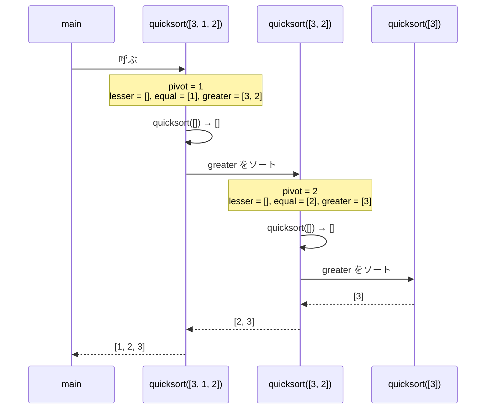
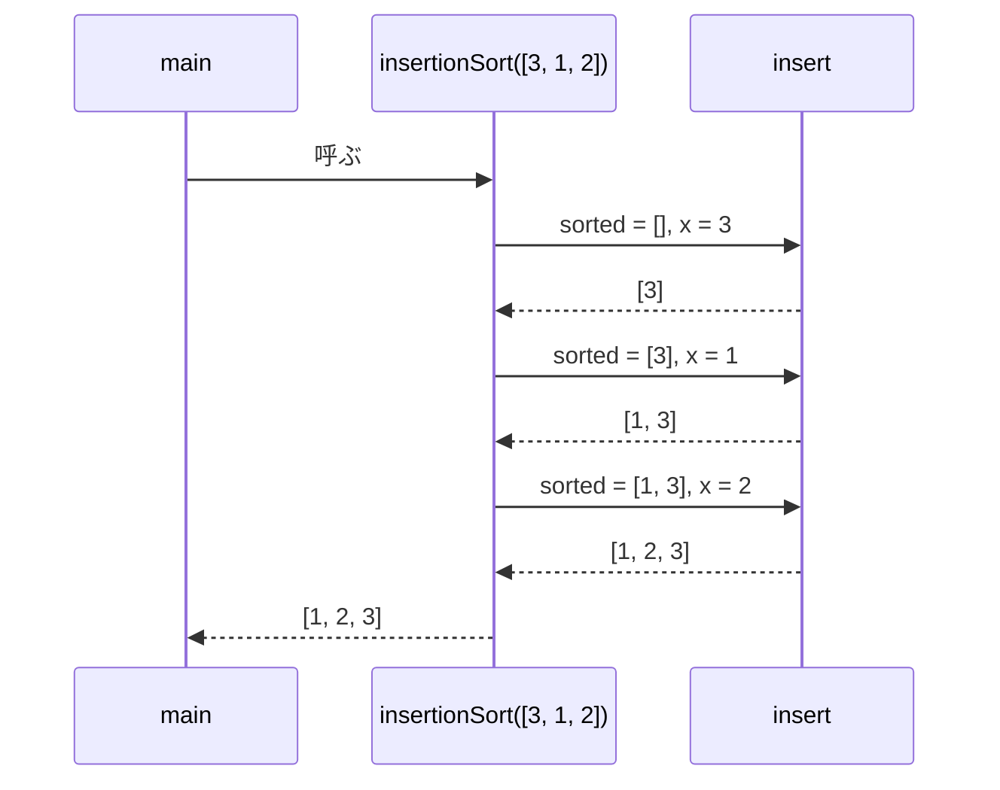

# favorites-2-sort

Wikipedia の[ソート](https://ja.wikipedia.org/wiki/%E3%82%BD%E3%83%BC%E3%83%88)の一覧から、クイックソートと挿入ソートを選んで TypeScript で実装しました。

どちらも、再代入をせず、渡された配列をいじらずに書けます。変数の値が途中で変わらないので、どの行を見ても「この名前はこの値」と言い切れて読むのが楽です。入力と出力が別物なので、呼ぶ側は渡した配列が壊れる心配をしなくて済みます。この書き方が好きで、それが素直にできる 2 つを選びました。

## クイックソート

[Wikipedia](https://ja.wikipedia.org/wiki/%E3%82%AF%E3%82%A4%E3%83%83%E3%82%AF%E3%82%BD%E3%83%BC%E3%83%88) / `src/quicksort.ts` / `src/quicksort.test.ts`

```ts
export function quicksort(xs: readonly number[]) {
  if (xs.length <= 1) return [...xs];
  const pivot = xs[Math.floor(xs.length / 2)]!;
  const lesser: number[] = quicksort(xs.filter((x) => x < pivot));
  const equal = xs.filter((x) => x === pivot);
  const greater: number[] = quicksort(xs.filter((x) => x > pivot));
  return [...lesser, ...equal, ...greater];
}
```



「ピボットより小さいものをソートしたもの、ピボット、大きいものをソートしたもの、をつなげる」という説明と、コードの行が 1 対 1 で対応しているのが好きです。並べ替えの手順ではなく「ソート済みとはこういうもの」を書いたら、結果がついてくる感じがします。

## 挿入ソート

[Wikipedia](https://ja.wikipedia.org/wiki/%E6%8C%BF%E5%85%A5%E3%82%BD%E3%83%BC%E3%83%88) / `src/insertionsort.ts` / `src/insertionsort.test.ts`

```ts
export function insertionSort(xs: readonly number[]) {
  // ソート済みの sorted に、x を小さい順の場所に差し込んだ新しい配列を返す
  const insert = (sorted: number[], x: number) => {
    const left = sorted.filter((y) => y <= x); // x 以下は左へ
    const right = sorted.filter((y) => y > x); // x より大きいは右へ
    return [...left, x, ...right];
  };

  return xs.reduce<number[]>(insert, []);
}
```



ソートという問題が「ソート済みの列に 1 つ足す」という小さい問題に置き換わっているのが好きです。小さい方は見れば正しいと分かるくらい単純で、それを `reduce` で繰り返すだけで全体ができてしまいます。

## 動かし方

```sh
bun install
bun test
```
